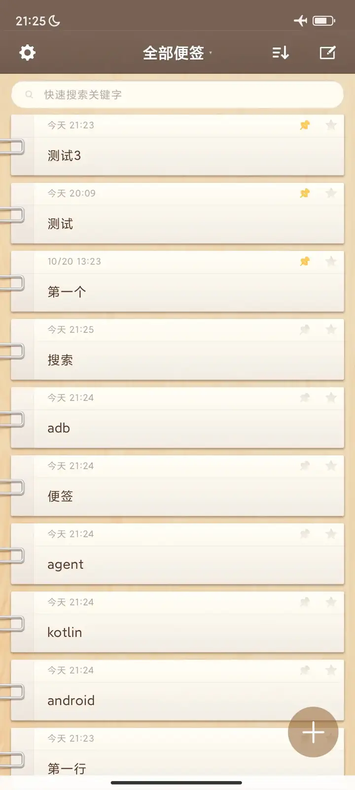

## swan notes
纯 kotlin 版 锤签，离线自用

## 目前状态
- 不支持 markdown 和 插入图片，text 编辑
- add **同步到本机文件夹**功能 (需设置文件夹，之后下拉可同步)
- add 首屏右下角 `+` 按钮，方便单手操作 (多年痛点)

## 技术相关
- 全程使用 `ds_flash_4.1`
- 参考原ts项目，先是用 tauri 编译 .so 到安卓，有两个问题，一个是 性能糟糕，上滑会卡顿 (比 kotlin 原生差远，可能也是手机问题); 第二是 agent 经过多层技术栈 很难迭代(遗忘，思考抓不到重点)，后面转 kotlin 就好很多

## 要求
- android 12+ 

## 软件截图

--- 

# 许可证 & acknowledge
- 项目代码 主要参考 `github.com/zhaoolee/notes (1.10.7)`
本 kotlin 项目同 `Apache License 2.0`
- 外观参考 原锤签 3.8.4 
- 第三方依赖及图片、字体、图标等第三方资源不因本项目的代码许可证而被重新授权